<picture>
  <source media="(prefers-color-scheme: dark)" srcset="./assets/banner-dark.svg">
  
</picture>

  
  

Desenvolvedor Full Stack e QA em Aracaju. Na **DocType Health** construo aplicações web para a área da saúde com Next.js, TypeScript e AWS. Na **LookInside** cuido da qualidade desde 2023: planejo e automatizo testes, valido APIs e acompanho bugs até a correção.

Por conta própria, criei e mantenho a **Santus**, uma loja de streetwear católico em produção, e o **PrintFlow**, o sistema que controla o estoque e a produção dela.

 

## O que eu faço

- Aplicações web com Next.js, React e TypeScript, do layout ao deploy
- Interfaces responsivas, pensadas primeiro para o celular
- APIs REST e integrações entre sistemas
- Infraestrutura serverless na AWS: Lambda, API Gateway, S3 e DynamoDB
- Banco de dados e autenticação com Supabase e PostgreSQL
- Testes funcionais, exploratórios, de regressão e de API
- Automação de testes de interface com Selenium
- Projetos de IA, incluindo treinamento de LLMs

 

## Em produção

### Santus &nbsp;<a href="https://www.santus.shop">santus.shop</a>

Loja completa, do catálogo ao checkout: coleções, área Kids, acessórios, tabela de medidas, busca e carrinho. Cache das páginas de produto com revalidação sob demanda, então o que muda no painel aparece na loja na hora, sem novo deploy. Imagens otimizadas para caber no plano gratuito do Supabase.

### PrintFlow &nbsp;código privado

Painel administrativo da Santus: controle de estoque e da produção das estampas, clientes, vendas, saldos e cupons, com gráficos de acompanhamento. Divide o banco com a loja e avisa a vitrine quando um produto muda.

 

## Outros projetos

| Projeto | O que é | Stack | Links |
| --- | --- | --- | --- |
| **Apenas um Católico** | Site de evangelização e devoção aos santos, com tema claro e escuro e PWA | React, styled-components | [site](https://joaocarlosteco.github.io/Apenas-um-Catolico/) · [código](https://github.com/JoaocarlosTeco/Apenas-um-Catolico) |
| **Brownie Reis** | Site de vendas para uma confeitaria artesanal, com filtro de produtos e pedido pelo WhatsApp | HTML, CSS, JavaScript | [site](https://joaocarlosteco.github.io/site-brownie-reis/) · [código](https://github.com/JoaocarlosTeco/site-brownie-reis) |
| **Javis** | 60 exercícios de lógica resolvidos e comentados | Java | [código](https://github.com/JoaocarlosTeco/javis) |

 

## Stack

### Front-end

### Back-end e nuvem

### Qualidade

### Ferramentas e outras linguagens

